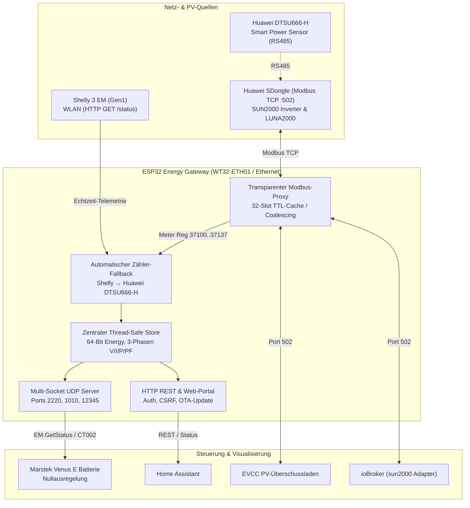

# ESP32 Energy Gateway (WT32-ETH01)

[](https://platformio.org/)
[](http://www.wireless-tag.com/)
[](LICENSE)

Industrietaugliche, echtzeitfähige Gateway-Firmware für das **WT32-ETH01** (ESP32 mit LAN8720 Ethernet PHY) zur lückenlosen Kopplung von:
* **Huawei SUN2000 Wechselrichtern** & **SDongle** (Modbus TCP)
* **Huawei DTSU666-H** Smart Power Sensor (Echtzeit-Netzzähler)
* **Shelly 3 EM (Gen1)** Stromzähler
* **Marstek Venus E** Heimspeicher (Nullausregelung via Shelly Pro 3EM / CT002 / CT003 Emulation)
* **EVCC**, **ioBroker** und **Home Assistant**

---

## 📐 Architektur & Funktionsweise



---

## ⚡ Features & Dienste

### 1. Unterbrechungsfreier Zähler-Fallback (Shelly ↔ Huawei DTSU666-H)
* **Problem gelöst:** Bricht das WLAN des Shelly 3 EM kurzzeitig ab oder startet der Shelly neu, verlor die Marstek-Batterie bisher die Netzinformationen und fiel in *«Kein CT / Offline»*.
* **Lösung:** Das Gateway überwacht den Shelly 3 EM kontinuierlich. Antwortet der Shelly nicht, liest das Gateway die 38 Holding-Register (`37100..37137`) des Huawei DTSU666-H über den Modbus-Proxy.
* **Vorzeichenanpassung:** Die Huawei-Vorzeichenkonvention (Einspeisung positiv, Bezug negativ) wird automatisch für Shelly/Marstek invertiert ($P_{\text{Shelly}} = -P_{\text{Huawei}}$).
* Sobald der Shelly wieder erreichbar ist, schaltet das Gateway ohne Unterbrechung sofort auf den Shelly zurück.

### 2. Transparenter Modbus TCP Caching Proxy (Port 502)
* **Single-Connection-Schutz:** Der Huawei SDongle unterstützt meist nur eine einzige TCP-Verbindung. Der Proxy serialisiert alle Anfragen und schützt den Dongle vor Überlastung.
* **Dynamischer 32-Slot TTL-Cache (Stale-While-Revalidate):**
  * Schnelle Steuerungsregister (Wirkleistung, Zähler, Akku) erhalten 1,5 s TTL für minimale Latenz.
  * Parallele Anfragen auf identische Blöcke werden zusammengefasst (*Request Coalescing*).
* **Huawei Speicher-Schreibschutz (Write Policy):**
  * Modus 0: Schreibzugriffe komplett gesperrt (Exception `0x01`).
  * Modus 1: Beobachtungsmodus (Schreibversuche nur im Web-UI loggen).
  * Modus 2: Aktiviert mit strikter **Allowlist** für Huawei LUNA2000 Steuerregister (Lade-/Entladeleistung `47075..47078`, Cutoff SOC `47081..47082`, Arbeitsmodus `47086..47088`).
  * 10-Einträge Ringpuffer zur Echtzeit-Analyse der Schreibbefehle im Web-UI.

### 3. Shelly Pro 3EM & CT002 UDP Server (Ports 2220, 1010, 12345)
* Multi-Socket UDP-Server für die Marstek Venus E Batterie.
* Unterstützt standardmäßiges Shelly Pro 3EM JSON-RPC 2.0 (`EM.GetStatus`, `Shelly.GetDeviceInfo`, `Shelly.GetStatus`).
* Liefert `"ct_state": 1` und die Phasenströme/Leistungen, sodass die Nullausregelung stabil arbeitet.
* Staleness-Drop: Sind Zählerdaten älter als 4 Sekunden, werden UDP-Pakete verworfen, um einen sicheren Timeout der Batterie zu erzwingen.

### 4. Web-Interface & Sicherheit
* **Responsive Web-Portal:** Live-Statusanzeige, Modbus-Schreiblog, Zählerquell-Status und Netzwerkeinstellungen.
* **Web OTA Firmware-Update:** Zwei-Slot-Partitionierung (`ota_0`, `ota_1` je 1920 KB) mit automatischem Bootloader-Rollback bei Fehlern.
* **Authentifizierung & CSRF-Schutz:** Salted SHA-256 Passwort-Hashing und `X-Requested-With`-Header-Schutz.
* **Hardware-Recovery Pin (GPIO32):** Pin CFG beim Booten auf GND ziehen erzwingt temporär DHCP und Admin-Zugang im RAM.

---

## 🔌 Port- & Protokollübersicht

| Port | Protokoll | Dienst | Verwendungszweck |
| :---: | :---: | :--- | :--- |
| **502** | TCP | Modbus TCP Proxy | ioBroker (`sun2000`), EVCC, openWB |
| **2220** | UDP | Shelly Pro 3EM Emulator | Marstek Venus E (`EM.GetStatus`) |
| **1010** | UDP | Marstek CT002/CT003 | Alternative Marstek Messprotokolle |
| **12345**| UDP | AstraMeter / Marstek Discovery | Broadcast Discovery |
| **80** | HTTP | Web UI & REST API | `/config`, `/api/status`, `/rpc/EM.GetStatus`, OTA `/update` |

---

## 🛠️ Hardware & Pinbelegung (WT32-ETH01)

Das Board basiert auf dem ESP32-D0WD-V3 und einem LAN8720A Ethernet-Transceiver:

| Funktion | ESP32 GPIO | WT32-ETH01 Pin | Beschreibung |
| :--- | :---: | :---: | :--- |
| **RMII CLK** | GPIO0 | - | Externe 50 MHz Taktung vom LAN8720 Oszillator |
| **PHY Power** | GPIO16 | - | Aktiviert Stromversorgung des LAN8720 (HIGH beim Boot) |
| **MDC** | GPIO23 | - | Ethernet Management Data Clock |
| **MDIO** | GPIO18 | - | Ethernet Management Data I/O |
| **TXD0 / TXD1** | GPIO19 / GPIO22 | - | RMII Sendedaten |
| **TX_EN** | GPIO21 | - | RMII Sendesteuerung |
| **RXD0 / RXD1** | GPIO25 / GPIO26 | - | RMII Empfangsdaten |
| **CRS_DV** | GPIO27 | - | RMII Carrier Sense / Data Valid |
| **Recovery Pin** | GPIO32 | **CFG** | Bei Boot auf GND: Erzwingt temporär DHCP & RAM-Reset |
| **Stromversorgung** | - | **5V / GND** | Empfohlen: 5V DC, min. 1A stabiles Netzteil |

---

## 🚀 Kompilieren & Flashen

### Voraussetzungen
* [PlatformIO CLI](https://platformio.org/) oder VS Code mit PlatformIO IDE Erweiterung.

### 1. Repository klonen
```bash
git clone https://github.com/eisi484/esp32-energy-gateway.git
cd esp32-energy-gateway
```

### 2. Kompilieren
```bash
pio run
```

### 3. Erstes Flashen via USB/UART
Da eine benutzerdefinierte 2-Slot-OTA Partitionstabelle geflasht wird, muss der allererste Flash seriell erfolgen:
1. **IO0** mit **GND** verbinden.
2. Board mit USB-UART-Adapter (3,3V Logikpegel an TX0/RX0) an den PC anschließen.
3. Reset-Taster drücken oder Board mit Spannung versorgen.
4. Flashen:
   ```bash
   pio run -t upload --upload-port /dev/ttyUSB0
   ```
5. **IO0 von GND trennen** und Board neu starten.

### 4. Zukünftige Updates per Web OTA
Nach dem ersten seriellen Flashen können alle weiteren Firmware-Updates direkt über den Browser im Reiter **Firmware-Update** hochgeladen werden:
```bash
# Oder per curl Befehl direkt aus dem Terminal:
curl -X POST --data-binary @.pio/build/wt32-eth01/firmware.bin \
  -H "Content-Type: application/octet-stream" \
  -H "X-Requested-With: XMLHttpRequest" \
  http://<GATEWAY-IP>/update
```

---

## ⚙️ Konfiguration

Nach dem ersten Start ist das Web-Portal per DHCP im Browser erreichbar:
```
http://<ESP32-IP>/config
# oder
http://esp32-energy-gateway.local/config
```

1. **Administrator-Passwort**: Beim ersten Aufruf vergeben.
2. **Huawei SDongle**:
   - IP-Adresse, Port `502`, Slave-ID `1` (WR1) und optional `2` (WR2).
   - In der FusionSolar App unter *Geräteverwaltung → SDongle → Modbus-TCP* prüfen, ob die IP-Adresse des Gateways freigegeben ist (bei Modus *Eingeschränkt*).
3. **Shelly 3 EM**:
   - IP-Adresse des realen Shelly 3 EM eintragen.
   - Phasenzuordnung (emeter 0..2 $\to$ Phase A..C) anpassen.
4. **Zähler-Fallback**:
   - *Aktiviert* auswählen, um bei Shelly-Ausfall unterbrechungsfrei auf die Huawei DTSU666-H Zählerdaten zu wechseln.

---

## 📋 Integrationen

### Marstek Venus E Heimspeicher
In der Marstek App:
* **Einstellungen** $\to$ **Netzmessung / Smart Meter** $\to$ **Shelly Pro 3EM** auswählen.
* Die IP-Adresse des ESP32 Gateway eingeben.
* Die Batterie fragt sofort UDP-Port `2220` ab und erhält Live-Netzdaten mit `< 200 ms` Latenz.

### EVCC (`evcc.yaml`)
```yaml
meters:
  - name: grid
    type: template
    template: shelly-3em
    usage: grid
    host: 192.168.2.103   # IP des Gateways

  - name: pv1
    type: modbus
    modbus:
      device: tcp
      host: 192.168.2.103   # IP des Gateways
      port: 502
      id: 1                # Slave ID WR 1
    power: 32080
    scale: 1
```

### ioBroker (`sun2000` Adapter)
* **IP-Adresse**: IP des Gateways
* **Port**: `502`
* **Slave-IDs**: `1` (und `2` falls Kaskade vorhanden)

---

## 📄 Lizenz

Dieses Projekt ist unter der [MIT License](LICENSE) lizenziert.
